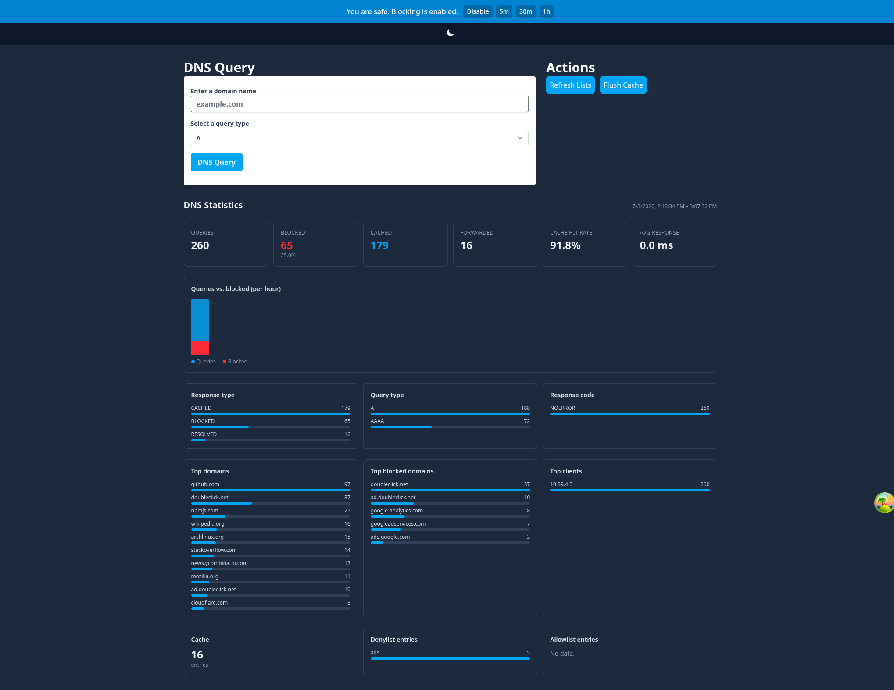
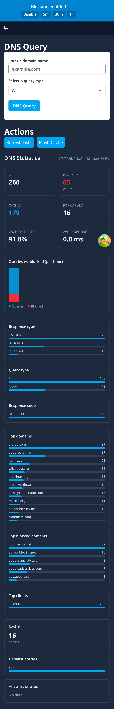

# Blocky Frontend

A frontend for the [blocky](https://github.com/0xERR0R/blocky) dns blocker.

## Compatibility

Blocky version each frontend release was built and tested against.

| blocky-frontend | blocky              | Notes                                                        |
| --------------- | ------------------- | ------------------------------------------------------------ |
| unreleased      | `v0.34.0`–`v0.35.0` | API client regenerated; stats `summary`/`perHour` gain `filtered` |
| `v1.3.0`        | `v0.33.0`           | Stats dashboard (needs `/api/stats`, blocky ≥ `v0.32.0`)     |
| `v1.0.0`–`v1.2.2` | `v0.28.2`         |                                                              |
| `v0.2.0`–`v0.2.2` | `v0.23`           |                                                              |
| `v0.0.1`–`v0.1.1` | `v0.19`           |                                                              |

## Screenshots

### Desktop



### Mobile



## Features

- Responsive Design (desktop & mobile)
- Enable / Disable Blocking, with timed pause (5m / 30m / 1h)
- DNS Query tool
- DNS Statistics dashboard (queries, blocked, cache hit rate, top domains/clients, per-hour chart)
- Refresh Blocklists
- Flush DNS Cache

## Run Locally

Clone the project

```bash
  git clone https://github.com/Mozart409/blocky-frontend
```

Go to the project directory

```bash
  cd blocky-frontend
```

Install dependencies

```bash
  pnpm install
```

Start blocky (podman-compose) and the development server

```bash
  just dev
```

Change the .env.example to .env.local for local development.

Production version frontend runs on [http://localhost:8002](http://localhost:8002)

```bash
  just up
```

## Authors

- [@Mozart409](https://www.github.com/mozart409)
